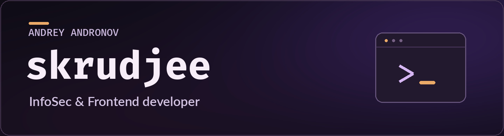
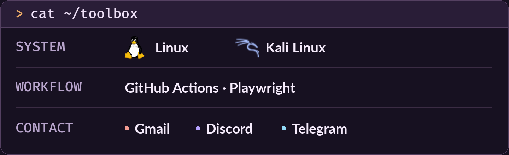

# Andrey Andronov

I study information security at **Novosibirsk State Technical University** and build web interfaces and tools for security workflows.

## Tech stack

      
     

## Toolbox

## Selected projects

- **[Sibcode Hackathon](https://github.com/skrudje/sibcode-hackathon)** · `React` · `TypeScript` · `Vite` — A recommendation platform built for the hackathon.
- **[Network scanner and topology analyzer](https://github.com/skrudje/Course-Work-2025)** — A multithreaded course project for scanning a local network and mapping its topology.
- **[Encryption algorithms coursework](https://github.com/skrudje/Encryption-Algorithm-RGR)** · `C++` — A console application for coursework on encryption algorithms.
- **[Security audit web service](https://github.com/Scudy007/cft)** · `TypeScript` — An internal web service for working with security audit results for financial systems.
- **[Rubezh access control](https://github.com/skrudje/rubezh-kpp)** · `TypeScript` — A software module for managing physical access to facilities and sites.

**Location** · Siberia, Russia  
**Contact** · [Gmail](mailto:skrudjbz@gmail.com)

Artwork credits: [Tux by Larry Ewing, made with GIMP](https://commons.wikimedia.org/wiki/File:Tux.png) · [Kali Linux icon via Simple Icons](https://github.com/simple-icons/simple-icons/blob/develop/icons/kalilinux.svg)
